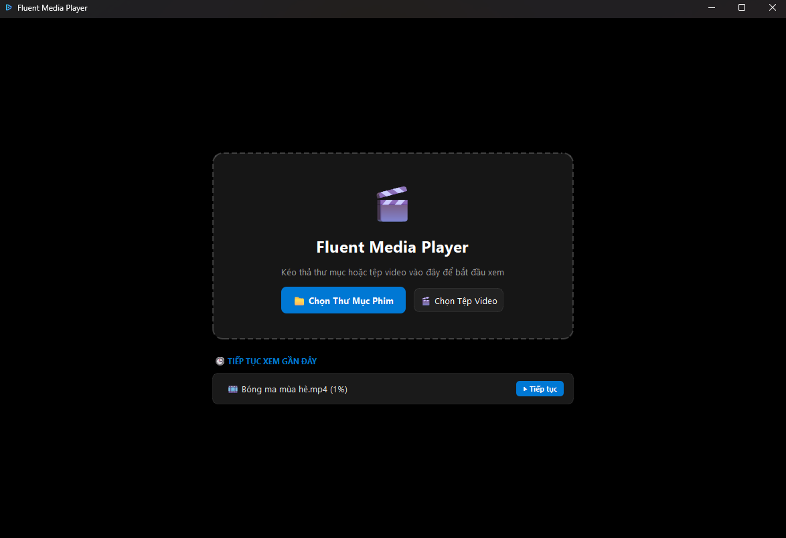
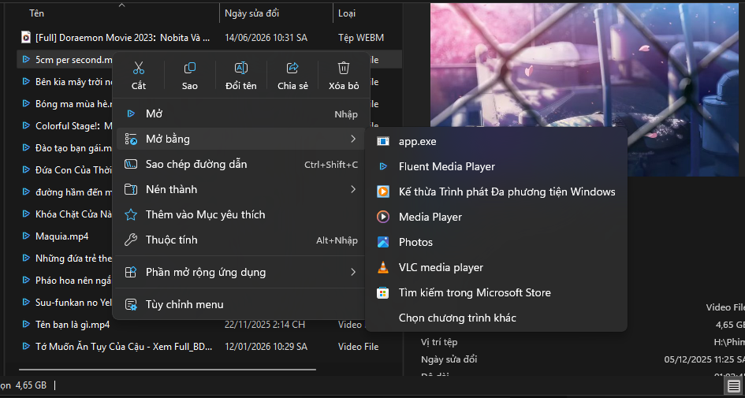

# Fluent Media Player

**Your Movies. Your Library. Your Experience.**

Đã cất công xây dựng cả một bộ sưu tập phim mà cứ hết tập lại phải thoát trình phát rồi tự đi tìm tập tiếp theo? Fluent Media Player giúp bạn mở thư mục phim, quản lý danh sách phát và chuyển tập ngay trong ứng dụng.

Đang xem dở mà có việc đột xuất? Không cần lo lắng. Tiến độ xem được lưu lại, cho phép bạn tiếp tục video từ đúng vị trí đã dừng trước đó.

Fluent Media Player là ứng dụng phát video trên Windows, được xây dựng bằng **Python, PyQt6 và libVLC**, hướng đến trải nghiệm xem phim cá nhân thuận tiện, liền mạch và dễ quản lý.

## Tải xuống

Truy cập [GitHub Releases](https://github.com/hoangviet24/film-library/releases/latest) để tải phiên bản mới nhất.

Hiện tại, ứng dụng cung cấp hai phiên bản:

| Phiên bản            | Mô tả                                                                       |
| -------------------- | --------------------------------------------------------------------------- |
| **Portable (.exe)**  | Không cần cài đặt. Tải về và chạy trực tiếp để trải nghiệm ứng dụng.        |
| **Installer (.exe)** | Bộ cài đặt dành cho người muốn cài ứng dụng vào Windows để sử dụng lâu dài. |

**Nên chọn phiên bản nào?**

- Chọn **Portable** nếu bạn chỉ muốn dùng thử hoặc không muốn cài đặt ứng dụng.
- Chọn **Installer** nếu bạn muốn tích hợp ứng dụng vào Windows và sử dụng thường xuyên.

Bạn không cần cài đặt Python hay các thư viện dành cho nhà phát triển để sử dụng các phiên bản đã đóng gói.

## Tính năng

### Video Playback

- Mở một video riêng lẻ hoặc quét toàn bộ thư mục cùng các thư mục con để tìm video.
- Phát video, tạm dừng, tua nhanh, tua lùi và điều chỉnh tốc độ phát.
- Điều chỉnh âm lượng và bật/tắt âm thanh.
- Hỗ trợ chế độ toàn màn hình (Fullscreen).
- Hỗ trợ cửa sổ phát video nổi (Popup Mode).

### Playlist &amp; Media Library

- Quản lý danh sách video được nhóm theo thư mục.
- Dễ dàng chuyển đổi giữa các tập phim mà không cần mở lại từng tệp.
- Hỗ trợ phát video theo danh sách phát (Playlist).
- Lưu lịch sử xem và vị trí phát gần nhất.
- Hiển thị các video đã xem gần đây.
- Hỗ trợ thêm video và thư mục bằng thao tác kéo thả.

### Seekbar Thumbnail Preview

Không còn phải tua video một cách mù quáng!

Lấy cảm hứng từ trải nghiệm trên YouTube, Fluent Media Player cung cấp tính năng xem trước nội dung ngay trên thanh tiến trình video.

- Khi di chuyển chuột qua thanh tiến trình, ứng dụng hiển thị một hình ảnh thu nhỏ (Thumbnail Preview) tương ứng với vị trí đang chọn.
- Hiển thị thời gian chính xác của đoạn video đang được xem trước.
- Giúp người dùng xác định nội dung tại vị trí muốn tua đến trước khi thực hiện thao tác.
- Hỗ trợ tìm kiếm những phân cảnh mong muốn dễ dàng và trực quan hơn.

### Windows Integration

- Hỗ trợ mở video trực tiếp từ Windows File Explorer thông qua tính năng **Open With**.
- Có thể khởi chạy ứng dụng và phát video được chọn mà không cần mở ứng dụng trước rồi tìm tệp thủ công.
- Cung cấp hai phương thức phân phối: Portable và Installer.

### Additional Features

- Tạo ảnh thu nhỏ (Thumbnail) cho video thông qua tiến trình chạy ngầm (yêu cầu OpenCV).
- Hỗ trợ nhiều chế độ hiển thị và điều khiển bằng bàn phím.

> Ứng dụng lọc các tệp có định dạng `.mp4`, `.mkv`, `.avi`, `.mov` và `.flv`. Việc phát tệp thực tế phụ thuộc vào các codec có sẵn trong môi trường chạy libVLC.

## Hướng dẫn sử dụng

### 1. Mở video

Có nhiều cách để mở video:

- **Open File:** Chọn một video riêng lẻ để phát.
- **Open Folder:** Chọn thư mục chứa phim để quét và hiển thị danh sách video.
- **Drag &amp; Drop:** Kéo thả video hoặc thư mục trực tiếp vào cửa sổ ứng dụng.
- **Open With:** Chuột phải vào video trong Windows File Explorer, chọn Open With và chọn Fluent Media Player.

### 2. Quản lý Playlist

Sau khi mở một thư mục, các video được tìm thấy sẽ xuất hiện trong danh sách phát.

Bạn có thể:

- Chọn tập phim muốn xem.
- Chuyển sang tập tiếp theo hoặc quay lại tập trước.
- Ẩn hoặc hiện thanh danh sách phát.
- Tiếp tục xem video từ vị trí đã lưu trước đó.

### 3. Tua video với Thumbnail Preview

Di chuyển con trỏ chuột đến vị trí mong muốn trên thanh tiến trình.

Ứng dụng sẽ hiển thị:

- Hình ảnh xem trước của đoạn video tương ứng.
- Timestamp của vị trí đang được chọn.

Bạn có thể quan sát nội dung trước khi nhấp để tua đến vị trí đó.

## Keyboard Shortcuts

| Phím tắt             | Chức năng                       |
| -------------------- | ------------------------------- |
| `Space`              | Phát / Tạm dừng                 |
| `Left` / `Right`     | Tua lùi / tiến 5 giây           |
| `Up` / `Down`        | Tăng / giảm âm lượng            |
| `M`                  | Bật / tắt âm thanh              |
| `F`                  | Bật / tắt chế độ toàn màn hình  |
| Double-click         | Phóng to / thu nhỏ video        |
| `Esc`                | Thoát chế độ toàn màn hình      |
| `P` / `Ctrl + Left`  | Video trước trong Playlist      |
| `N` / `Ctrl + Right` | Video tiếp theo trong Playlist  |
| `B`                  | Hiện / ẩn thanh Playlist        |
| `Ctrl + O`           | Mở thư mục                      |
| `O`                  | Mở tệp                          |
| `[` / `]`            | Giảm / tăng tốc độ phát (0.25x) |

## Yêu cầu hệ thống

- **Operating System:** Windows 10 / Windows 11 (64-bit).
- **Architecture:** x64.
- Các hệ điều hành khác hiện chưa được hỗ trợ.

## Công nghệ sử dụng

| Công nghệ   | Vai trò                       |
| ----------- | ----------------------------- |
| Python      | Ngôn ngữ lập trình chính      |
| PyQt6       | Xây dựng giao diện người dùng |
| libVLC      | Xử lý và phát video           |
| OpenCV      | Hỗ trợ xử lý và tạo Thumbnail |
| PyInstaller | Đóng gói ứng dụng Windows     |

## Chạy từ mã nguồn (dành cho nhà phát triển)

### Requirements

- Windows.
- Python 3.10 trở lên.
- PyQt6.
- python-vlc.
- VLC/libVLC runtime tương thích.
- OpenCV (tùy chọn, dùng cho tính năng tạo Thumbnail).

### Installation

Sử dụng PowerShell từ thư mục dự án:

```
python -m venv .venv
.\.venv\Scripts\Activate.ps1

python -m pip install --upgrade pip
python -m pip install PyQt6 python-vlc opencv-python

python app.py
```

Nếu chỉ cần các thư viện bắt buộc:

```
python -m pip install PyQt6 python-vlc
```

Ứng dụng cần môi trường chạy VLC/libVLC cùng các plugin tương thích. Trên Windows, tệp [`config.py`](http://config.py) sẽ tìm kiếm thư mục runtime `vlc/` nằm cạnh [`app.py`](http://app.py) để cấu hình đường dẫn DLL và plugin nếu thư mục này tồn tại.

Nếu không có thư mục đó, cần đảm bảo VLC/libVLC tương thích đã được cài đặt và có thể truy cập bởi Python.

## Cấu hình và dữ liệu đã lưu

Các thiết lập ứng dụng được định nghĩa trong [`config.py`](http://config.py).

Một số dữ liệu được tạo trong quá trình sử dụng:

- `video_history.json` — Lưu lịch sử và vị trí phát video.
- `thumb_cache/` — Lưu các hình ảnh Thumbnail được tạo ra.

Các đường dẫn này được xác định dựa trên thư mục ứng dụng khi chạy từ mã nguồn.

## Cấu trúc dự án

```
.
├── app.py
├── config.py
├── main_window.py
├── player_controller.py
├── styles.py
├── assets/
│   ├── logo.ico
│   ├── logo.png
│   └── ...
├── utils/
│   ├── history.py
│   └── thumbnail.py
└── widgets/
    └── ...
```

## Screenshots






## Platform Support

Fluent Media Player hiện được phát triển và tối ưu cho Windows.

Ứng dụng sử dụng Windows HWND để nhúng nội dung video vào cửa sổ giao diện thông qua libVLC. Các nền tảng khác hiện chưa được hỗ trợ hoặc xác minh.

---

**Fluent Media Player — Enjoy your collection, one episode at a time.**
