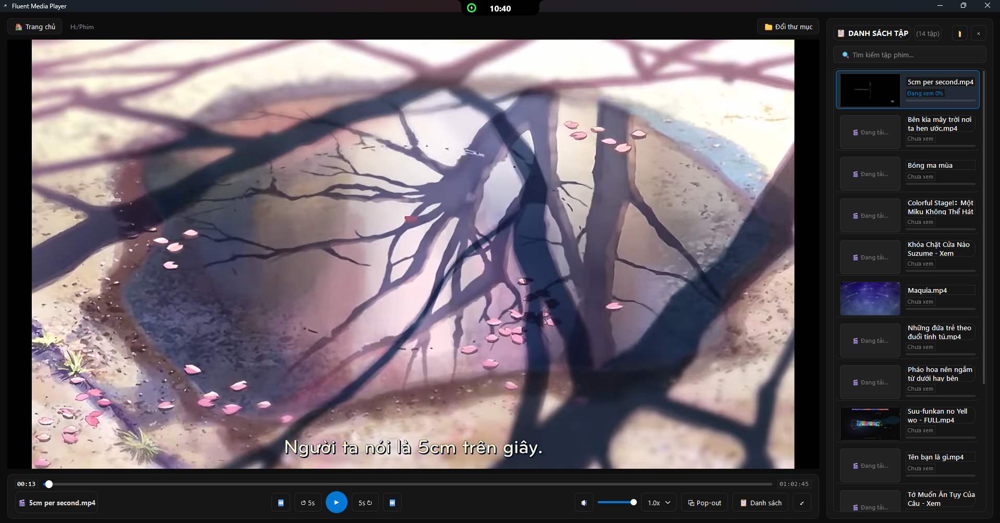
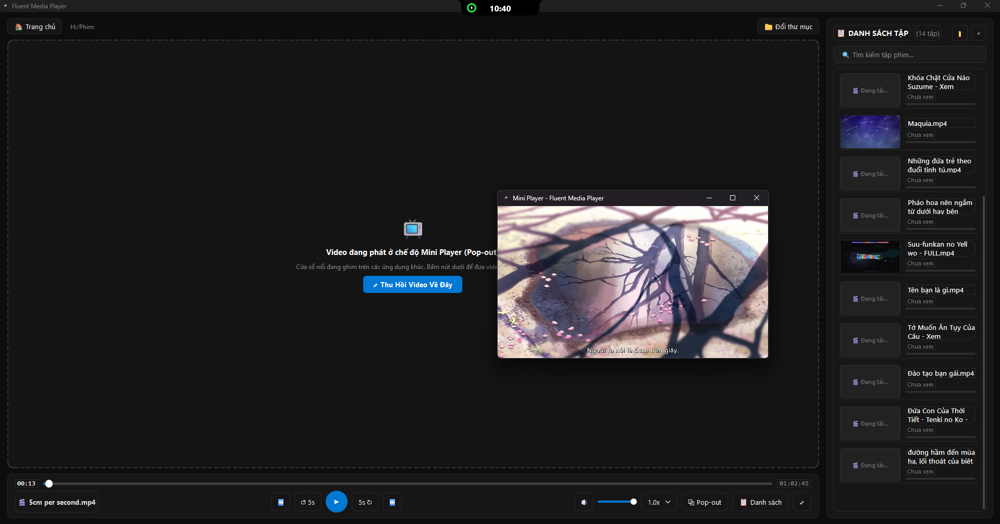

# Fluent Media App

Đã cất công xây dựng cả một bộ sưu tập phim mà cứ hết tập lại phải thoát trình phát rồi tự đi tìm tập tiếp theo? Fluent Media Player giúp bạn mở thư mục phim và chọn tập ngay trong danh sách để xem tiếp.

Đang xem dở mà sếp gọi đi làm? Cứ đóng app rồi đi giải cứu nền kinh tế. Tiến độ xem được lưu lại, nên khi về bạn có thể mở lại video từ chỗ đang xem dở.

Fluent Media Player là ứng dụng phát video trên máy tính, được xây dựng bằng Python, PyQt6 và libVLC.

# Tải và chạy

Hãy tải xuống tệp [**`app.zip`**](http://app.zip) mới nhất từ ​​trang [GitHub Releases](https://github.com/hoangviet24/film-library/releases/latest), giải nén tệp đó, rồi mở ứng dụng từ thư mục vừa giải nén. Bạn không cần phải cài đặt Python hay các thành phần phụ thuộc dành cho nhà phát triển (development dependencies) để sử dụng phiên bản đã đóng gói này.

# Tính năng

- Mở một video hoặc quét một thư mục cùng các thư mục con để tìm video.
- Duyệt các video được nhóm theo thư mục chứa chúng và di chuyển giữa các mục trong danh sách phát.
- Phát, tạm dừng, tua video, thay đổi âm lượng, tắt tiếng và điều chỉnh tốc độ phát.
- Chuyển sang chế độ toàn màn hình hoặc mở video trong cửa sổ trình phát thu nhỏ dạng nổi.
- Lưu vị trí phát và hiển thị các video đã xem gần đây trên màn hình chính.
- Tạo ảnh thu nhỏ (thumbnail) cho video thông qua tiến trình chạy ngầm (yêu cầu cài đặt OpenCV).
- Hỗ trợ thêm tệp video và thư mục bằng thao tác kéo thả.

> Ứng dụng lọc các tệp có định dạng `.mp4`, `.mkv`, `.avi`, `.mov` và `.flv`. Việc phát tệp thực tế phụ thuộc vào các codec có sẵn trong môi trường chạy libVLC đã được cài đặt.

# Các Yêu cầu để chạy từ mã nguồn

\- Windows là nền tảng được mã nguồn hiện tại thiết lập để nhúng video VLC vào cửa sổ ứng dụng.

\- Python 3.10 hoặc mới hơn.

\- Các gói Python bao gồm `PyQt6` và `python-vlc`.

\- Môi trường chạy (runtime) VLC/libVLC gốc. Kho lưu trữ này không bao gồm các tệp nhị phân của VLC. Trên Windows, tệp [`config.py`](http://config.py) sẽ tìm kiếm thư mục runtime `vlc/` nằm cạnh tệp [`app.py`](http://app.py) và tự động cấu hình các đường dẫn đến tệp DLL cũng như các plugin nếu thư mục này tồn tại. Nếu không, bạn cần đảm bảo rằng một phiên bản VLC/libVLC tương thích đã được cài đặt và có thể truy cập được bởi Python.

\- Tùy chọn: `opencv-python` dùng để tạo ảnh thu nhỏ (thumbnail) xem trước. Nếu thiếu gói này, các tính năng phát video và lưu lịch sử xem vẫn hoạt động bình thường, nhưng các ảnh thu nhỏ sẽ không được tạo ra.

> Trong kho lưu trữ không có tệp khóa phụ thuộc (dependency lockfile) hay tệp liệt kê yêu cầu (requirements file); hãy cài đặt trực tiếp các gói được liệt kê ở trên.

# Chạy từ mã nguồn (dành cho nhà phát triển)

#### Để chạy mã nguồn thay vì ứng dụng đã đóng gói, hãy sử dụng PowerShell từ thư mục dự án:

```bash
python -m venv .venv
.\.venv\Scripts\Activate.ps1
python -m pip install --upgrade pip
python -m pip install PyQt6 python-vlc opencv-python
python app.py
```

`opencv-python` là tùy chọn. Để chỉ cài đặt các gói Python bắt buộc, hãy sử dụng:

```bash
python -m pip install PyQt6 python-vlc
```

Hãy chạy lệnh `python `[`app.py`](http://app.py) từ thư mục gốc của kho lưu trữ. Nếu ứng dụng không thể tải VLC, hãy kiểm tra xem thư viện runtime libVLC cùng các plugin của nó đã được cài đặt và hệ thống có thể tìm thấy chúng hay chưa; hoặc bạn có thể đặt thư viện runtime tương thích vào thư mục `vlc/` nằm cùng cấp với tệp [`app.py`](http://app.py).

# Sử dụng trình phát

Chọn **Mở thư mục** (Open folder) để quét thư viện video, hoặc **Mở tệp** (Open file) để bắt đầu phát một video riêng lẻ. Khi mở một tệp, các tệp video được hỗ trợ nằm trong cùng thư mục đó cũng sẽ được liệt kê. Bạn có thể kéo thả một tệp video (được hỗ trợ) hoặc một thư mục vào cửa sổ ứng dụng để mở. Sử dụng thanh bên danh sách phát để chọn video; tiến trình phát sẽ được lưu lại, cho phép bạn tiếp tục xem từ màn hình chính.

| Key                           | Action                             |
| ----------------------------- | ---------------------------------- |
| `Space`                       | Phát hoặc dừng                     |
| `Left \ Right`                | Tiến \\ lùi 5 giây                 |
| `Up \ Down`                   | Tăng \\ giảm âm lượng              |
| `M`                           | Mở \\ tắt âm thanh                 |
| `F` or double-click the video | Phóng to hoặc thu nhỏ video        |
| `Esc`                         | Thoát chế độ toàn màn hình         |
| `P` or `Ctrl+Left`            | Lùi về video trước trong Playlist  |
| `N` or \`Ctrl+Right           | Tiến về video trước trong Playlist |
| `B`                           | Hiện hoặc ẩn thanh danh sách phát  |
| `Ctrl+O`                      | Mở folder                          |
| `O`                           | Mở file                            |
| `[/]`                         | Tăng \\ Giảm tốc độ phát x0.25     |

# ## Cấu hình và dữ liệu đã lưu

Các thiết lập ứng dụng được định nghĩa trong tệp [`config.py`](http://config.py). Các phần mở rộng tệp video hiện được hỗ trợ được liệt kê trong `VALID_VIDEO_EXTENSIONS`. Cơ chế tự động phát hiện VLC sẽ kiểm tra sự tồn tại của thư mục `vlc/` nằm cạnh các tệp ứng dụng; nếu thư mục này tồn tại, nó sẽ thiết lập các đường dẫn đến tệp DLL và các plugin của VLC trên hệ điều hành Windows.

Khi chạy từ mã nguồn, ứng dụng lưu trữ:

\- `video_history.json` — lưu trữ vị trí và tiến trình xem video.

\- `thumb_cache/` — chứa các hình ảnh thu nhỏ (thumbnail) được tạo ra (khi đã cài đặt OpenCV).

Các đường dẫn này được xác định dựa trên thư mục ứng dụng. Tệp lịch sử này bị Git bỏ qua; thư mục `thumb_cache/` cũng được loại trừ.

# Cấu trúc dự án


```
.
├── app.py                 # Application entry point
├── config.py              # Runtime paths, history/cache locations, extensions
├── main_window.py         # Main window, navigation, playback UI, shortcuts
├── player_controller.py   # libVLC playback controls
├── styles.py              # Shared colors and Qt styles
├── assets/
│   ├── logo.ico
│   └── logo.png
├── utils/
│   ├── history.py         # Playback history persistence
│   └── thumbnail.py       # Optional thumbnail generation
└── widgets/               # Player, playlist, overlay, and floating-window widgets
```

# Screeshots



# Ghi chú về nền tảng

Trình phát nhúng video thông qua một handle cửa sổ Windows (`HWND`). Các nền tảng khác chưa được xác minh bởi mã nguồn trong kho lưu trữ này. Việc hỗ trợ các định dạng video và âm thanh phụ thuộc vào bản dựng libVLC đã cài đặt và các codec hiện có.
